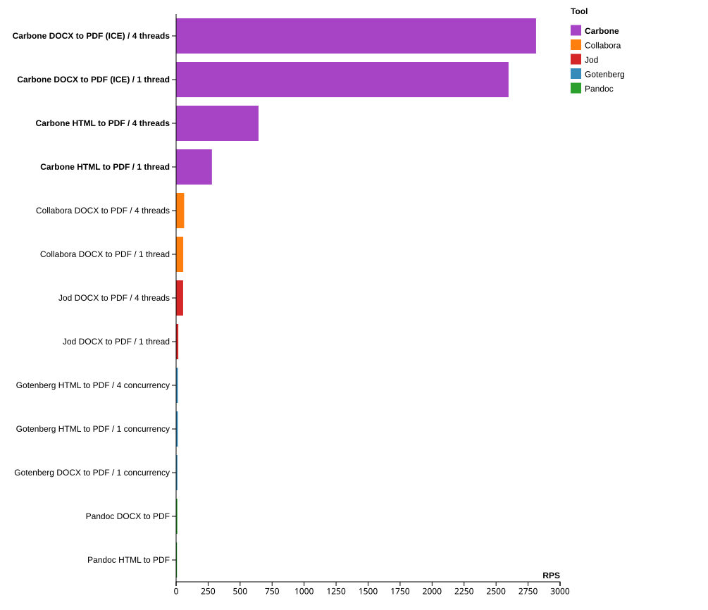

# 📊 Document Converter Performance Benchmark

> **Comprehensive performance comparison of popular free document conversion tools**

[](LICENSE)
[](https://k6.io)

A detailed performance benchmark comparing the most popular free and open-source document conversion solutions: **Carbone**, **Collabora**, **Jod-converter**, and **Gotenberg**. This repository provides real-world performance metrics, helping you choose the right tool for your document conversion needs.

---

## 🎯 Quick Results



### Performance Summary

<!-- BENCH:SUMMARY:START -->
| Tool              | Threads         | Conversion | Avg Latency | Throughput (RPS) |
| ----------------- | --------------- | ---------- | ----------- | ---------------- |
| **Carbone**       | 4 (ice)         | DOCX → PDF | 1.69ms      | 2812.39          |
| **Carbone**       | 1 (ice)         | DOCX → PDF | 1.84ms      | 2597.40          |
| **Carbone**       | 4 (chrome)      | HTML → PDF | 7.50ms      | 643.89           |
| **Carbone**       | 1 (chrome)      | HTML → PDF | 17.56ms     | 279.76           |
| **Collabora**     | 4 (libreoffice) | DOCX → PDF | 79.07ms     | 62.75            |
| **Collabora**     | 1 (libreoffice) | DOCX → PDF | 89.21ms     | 55.64            |
| **Jod-converter** | 4 (libreoffice) | DOCX → PDF | 91.00ms     | 54.72            |
| **Jod-converter** | 1 (libreoffice) | DOCX → PDF | 292.54ms    | 17.04            |
| **Gotenberg**     | 4 (chrome)      | HTML → PDF | 371.65ms    | 13.43            |
| **Gotenberg**     | 1 (chrome)      | HTML → PDF | 377.21ms    | 13.24            |
| **Gotenberg**     | 1 (libreoffice) | DOCX → PDF | 499.59ms    | 9.98             |
| **Pandoc**        | n/a (latex)     | DOCX → PDF | 526.94ms    | 9.45             |
| **Pandoc**        | n/a (latex)     | HTML → PDF | 734.28ms    | 6.79             |

> 💡 **Key Finding**: Carbone consistently outperforms other solutions, achieving up to **2812.39 RPS** for DOCX to PDF conversions (4 threads).
<!-- BENCH:SUMMARY:END -->

> ℹ️ **Carbone DOCX → PDF** uses [Carbone ICE](https://carbone.io/documentation/developer/http-api/generate-reports.html#converters) (`"converter": "I"`), the converter built into Carbone, with no office suite involved. Carbone + LibreOffice (`"converter": "L"`) is still measured in every run, see [RESULT.md](RESULT.md).

> ⚡ **Performance Note**: Carbone could potentially be even faster, as it performs additional parsing to detect Carbone tags within documents in addition to the conversion process. This means Carbone is doing more work (template parsing + conversion) while still achieving the best performance.

> **Gotenberg** does not support multi-threading for LibreOffice

## 📈 Key Insights

<!-- BENCH:INSIGHTS:START -->
- ⚡ **Fastest Overall**: Carbone with 4 threads (1.69ms avg for DOCX→PDF)
- 🚀 **Best Scalability**: Jod-converter gets 3.2x more throughput on DOCX→PDF when going from 1 to 4 threads
- 📄 **DOCX Conversion**: Carbone leads with 1.69ms (4 threads) vs 79.07ms (Collabora)
- 🌐 **HTML Conversion**: Carbone leads with 7.50ms (4 threads) vs 371.65ms (Gotenberg)
<!-- BENCH:INSIGHTS:END -->


## 🛠️ Tools Tested

| Tool | Version | Description |
|------|---------|-------------|
| [**Carbone Community Edition**](https://carbone.io) | 5.16.0 | Document generation/conversion engine (converters: Carbone ICE, LibreOffice, Chrome) |
| [**Collabora**](https://www.collaboraoffice.com) | Latest | LibreOffice-based document server |
| [**Jod-converter**](https://github.com/jodconverter/jodconverter) | Latest | Java-based document converter |
| [**Gotenberg**](https://gotenberg.dev) | 8.38.1 | Docker-powered document conversion API |

---

## 🚀 Getting Started

### Prerequisites

- [Docker](https://www.docker.com/get-started) installed and running
- [k6](https://k6.io) for load testing

### Install k6

```bash
# macOS
brew install k6

# Linux (not tested)
sudo gpg -k
sudo gpg --no-default-keyring --keyring /usr/share/keyrings/k6-archive-keyring.gpg --keyserver hkp://keyserver.ubuntu.com:80 --recv-keys C5AD17C747E3415A3642D57D77C6C491D6AC1D53
echo "deb [signed-by=/usr/share/keyrings/k6-archive-keyring.gpg] https://dl.k6.io/deb stable main" | sudo tee /etc/apt/sources.list.d/k6.list
sudo apt-get update
sudo apt-get install k6

# Windows
choco install k6
```

### ⚙️ Automated run

A zero-dependency Node.js CLI ([`bench.mjs`](bench.mjs), Node.js 22+) runs the whole benchmark. For each configuration it starts the Docker container, waits until it converts its first document, checks that the response is a valid PDF (saved to `output/`), sends a few warmup conversions, runs k6, and stops the container. When everything is done, it regenerates the summary table and insights in this README, [RESULT.md](RESULT.md), and [result.svg](result.svg) from [`results/summary.json`](results/summary.json).

```bash
# Full benchmark (about 25 minutes), then regenerate the docs
node bench.mjs run

# Only check that every converter produces a valid PDF (no load test)
node bench.mjs verify

# Benchmark a subset: a tool, a service, a test, a format or a variant (ice, libreoffice)
node bench.mjs run --only carbone
node bench.mjs run --only gotenberg-4,pandoc-html
node bench.mjs run --only html --duration 30s --vus 10

# Regenerate README.md, RESULT.md and result.svg from the stored results
node bench.mjs report

# List services and tests, or show every option
node bench.mjs list
node bench.mjs --help
```

Services and tests are declared in [`benchmarks.config.mjs`](benchmarks.config.mjs). Each k6 script also reads the `BASE_URL`, `VUS` and `DURATION` environment variables, so it can still be run by hand as described below.

---

## 📋 Benchmarking Guide

### 🔴 JOD Converter

#### 1. Start JOD Converter

```bash
# Single thread
docker run --rm -p 8080:8080 \
  -v "$PWD/jod/application-1.properties:/etc/app/application.properties:ro" \
  ghcr.io/jodconverter/jodconverter-examples:rest

# Multi-thread (4 threads)
docker run --rm -p 8080:8080 \
  -v "$PWD/jod/application-4.properties:/etc/app/application.properties:ro" \
  ghcr.io/jodconverter/jodconverter-examples:rest
```

#### 2. Verify Conversion

```bash
curl -v \
  -F "data=@./sample.docx" \
  http://localhost:8080/lool/convert-to/pdf \
  --output outputJod.pdf
```

#### 3. Run Benchmark

```bash
k6 run jod-converter.js
```


### 🟠 Collabora Converter

#### 1. Start Collabora

```bash
# Single thread
docker rm -f collabora
docker run -d --name collabora --privileged -t \
  -p 127.0.0.1:9980:9980 \
  -e "extra_params=--o:ssl.enable=false --o:ssl.termination=true --o:per_document.max_concurrency=1 --o:num_prespawn_children=1" \
  collabora/code

# Fix systemplate warning (older images only, recent images no longer ship coolconfig)
docker exec -u 0 collabora coolconfig update-system-template

# Multi-thread (4 threads)
docker run -d --name collabora --privileged -t \
  -p 127.0.0.1:9980:9980 \
  -e "extra_params=--o:ssl.enable=false --o:ssl.termination=true --o:per_document.max_concurrency=4 --o:num_prespawn_children=4" \
  collabora/code
```

> ⚠️ **Note**: `--privileged` flag is required to avoid `/usr/bin/coolmount: Operation not permitted` errors.

#### 2. Verify Conversion

```bash
curl -k \
  -F "data=@./sample.docx" \
  http://localhost:9980/cool/convert-to/pdf \
  --output outputCollabora.pdf
```

#### 3. Run Benchmark

```bash
k6 run collabora-converter.js
```


### 🟣 Carbone Converter

**Version**: 5.16.0

#### 1. Start Carbone

```bash
# Single thread
docker run -t -i --rm -p 4000:4000 \
  carbone/carbone-ee:full-5.16.0 webserver -s -f 1

# Multi-thread (4 threads)
docker run -t -i --rm -p 4000:4000 \
  carbone/carbone-ee:full-5.16.0 webserver -s -f 4
```

#### 2. Verify Conversion

**DOCX to PDF** (using Carbone ICE, `"converter": "I"`):

```bash
base64_template=$(base64 < ./sample.docx | tr -d '\r\n')
curl -k \
  -H "Content-Type: application/json" \
  -d "{\"data\": {}, \"converter\":\"I\", \"template\": \"data:application/vnd.openxmlformats-officedocument.wordprocessingml.document;base64,${base64_template}\", \"convertTo\": \"pdf\"}" \
  http://localhost:4000/render/template?download=true \
  --output outputCarboneICE.pdf
```

**DOCX to PDF** (using LibreOffice, `"converter": "L"`):

```bash
base64_template=$(base64 < ./sample.docx | tr -d '\r\n')
curl -k \
  -H "Content-Type: application/json" \
  -d "{\"data\": {}, \"converter\":\"L\", \"template\": \"data:application/vnd.openxmlformats-officedocument.wordprocessingml.document;base64,${base64_template}\", \"convertTo\": \"pdf\"}" \
  http://localhost:4000/render/template?download=true \
  --output outputCarbone.pdf
```

**HTML to PDF** (using Chrome):

```bash
base64_html=$(base64 < ./sample.html | tr -d '\r\n')
curl -k \
  -H "Content-Type: application/json" \
  -d "{\"data\": {}, \"converter\":\"C\", \"template\": \"data:text/html;base64,${base64_html}\", \"convertTo\": \"pdf\"}" \
  http://localhost:4000/render/template?download=true \
  --output outputCarboneHTML.pdf
```

#### 3. Run Benchmark

```bash
# DOCX to PDF conversion with Carbone ICE
k6 run -e CONVERTER=I carbone-converter.js

# DOCX to PDF conversion with LibreOffice (default of the script)
k6 run carbone-converter.js

# HTML to PDF conversion
k6 run carbone-converter-html.js
```


### 🔵 Gotenberg Converter

**Version**: 8.38.1

#### 1. Start Gotenberg

```bash
# Single thread
docker run --rm -p 4000:3000 \
  gotenberg/gotenberg:8.38.1 \
  gotenberg \
  --chromium-auto-start=true

# Multi-thread (4 concurrency)
docker run --rm -p 4000:3000 \
  gotenberg/gotenberg:8.38.1 \
  gotenberg \
  --chromium-max-concurrency=4 \
  --chromium-auto-start=true
```

#### 2. Verify Conversion

```bash
# HTML to PDF
curl -v \
  -X POST "http://localhost:4000/forms/chromium/convert/html" \
  -F "files=@./sample.html;filename=index.html" \
  -o outputGotenberg.pdf

# DOCX to PDF
curl -v \
  -X POST "http://localhost:4000/forms/libreoffice/convert" \
  -F "files=@./sample.docx;filename=sample.docx" \
  -o outputGotenbergDOCX.pdf
```

#### 3. Run Benchmark

```bash
# HTML to PDF
k6 run gotenberg-converter-html.js

# DOCX to PDF
k6 run gotenberg-converter.js
```


### 🟢 Pandoc Converter

**Version**: Latest

> ⚠️ **Note**: Pandoc's built-in server (`pandoc --server`) cannot produce PDF, because PDF output requires an external engine (LaTeX). A minimal HTTP wrapper (see [`pandoc/`](pandoc/)) shells out to the pandoc CLI from the `pandoc/latex` image so it can be benchmarked over HTTP like the other tools. PDF is rendered through LaTeX, so complex HTML/CSS layouts render differently than with a Chrome-based engine.

#### 1. Start Pandoc

```bash
# Build the wrapper image (once)
docker build -t pandoc-bench ./pandoc

# Run the HTTP wrapper
docker run --rm -p 3030:3030 pandoc-bench
```

> Pandoc has no thread/concurrency flag: each request spawns its own pandoc process, so concurrency scales with the available CPUs.

#### 2. Verify Conversion

```bash
# HTML to PDF
curl -v \
  -X POST "http://localhost:3030/html-to-pdf" \
  --data-binary "@./sample.html" \
  -o outputPandocHTML.pdf

# DOCX to PDF
curl -v \
  -X POST "http://localhost:3030/docx-to-pdf" \
  --data-binary "@./sample.docx" \
  -o outputPandoc.pdf
```

#### 3. Run Benchmark

```bash
# HTML to PDF
k6 run pandoc-converter-html.js

# DOCX to PDF
k6 run pandoc-converter.js
```

---

## 📊 Benchmark Methodology

### Test Environment

**Hardware Specifications:**
- **Device**: MacBook Pro with M4 Max
- **CPU**: Apple M4 Max chip
- **Architecture**: ARM64 (Apple Silicon)
- **Container Runtime**: Docker Desktop

<!-- BENCH:ENVIRONMENT:START -->
**Software Versions:**
- **Benchmark Date**: October 21st, 2026
- **k6**: v2.2.0 | **Docker Engine**: 29.9.1 (14 CPUs, 8 GB allocated to Docker)
- **Docker Images**:
  - Jod-converter: `ghcr.io/jodconverter/jodconverter-examples:rest` (built 2025-09-20, digest `sha256:3213ae4931b8`, amd64)
  - Collabora: `collabora/code:latest` (built 2026-10-09, digest `sha256:bb8f3c9c5c90`, arm64)
  - Carbone Community Edition (Free Edition): `carbone/carbone-ee:full-5.16.0` (built 2026-10-20, digest `sha256:9cc31ce7e861`, arm64)
  - Gotenberg: `gotenberg/gotenberg:8.38.1` (version 8.38.1, built 2026-10-15, digest `sha256:aa552cc115db`, arm64)
  - Pandoc: `pandoc-bench` (version 3.11, built 2026-10-20, digest `sha256:5aac982c2e7d`, amd64, wrapped with a minimal HTTP server, see [`pandoc/`](pandoc/))

### Test Configuration

- **Load Testing Tool**: [k6](https://k6.io) by Grafana Labs
- **Test Duration**: 60 seconds per configuration
- **Virtual Users**: 5 concurrent users
- **Warmup**: 10 verified conversions before each run (excluded from the results)
- **Metrics Collected**:
  - Average latency (ms)
  - Requests per second (RPS)
  - 95th percentile latency
  - Error rates
<!-- BENCH:ENVIRONMENT:END -->

> ⚠️ **Note**: All benchmarks were run using Docker containers on macOS. Performance may vary on different hardware configurations and operating systems.

> ⚠️ **Note**: The Jod-converter and Pandoc (`pandoc/latex`) images are only published for `amd64`, so they run under emulation on Apple Silicon (`--platform linux/amd64`).

For detailed results, see [RESULT.md](RESULT.md).


## 📝 Sample Files

This repository includes sample files for testing:

- `sample.docx` - Sample Word document
- `sample.html` - Sample HTML file


## 🤝 Contributing

Contributions are welcome! If you'd like to:

- Add more document converters to the benchmark
- Improve the testing methodology
- Fix issues or improve documentation

Please feel free to open an issue or submit a pull request.


## 📄 License

This project is licensed under the Apache License 2.0 - see the [LICENSE](LICENSE) file for details.


## 🙏 Acknowledgments

- [k6](https://k6.io) - Load testing tool
- All the open-source document converter projects tested


## ⭐ Star History

If you find this benchmark useful, please consider giving it a star! ⭐


**Made with ❤️ for the open-source community**
